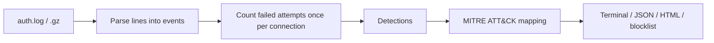

# auth-log-analyzer

[](https://github.com/yusufiyilmaz/auth-log-analyzer/actions/workflows/tests.yml)


[](LICENSE)

**English** | [Türkçe](README.tr.md)

A command-line tool that analyzes Linux `auth.log` files and reports SSH attacks, suspicious `sudo` use and account changes.
Findings are mapped to **MITRE ATT&CK** techniques, and the same detections ship as **Sigma rules** for use in a SIEM.


## Contents

- [Features](#features)
- [Quick start](#quick-start)
- [Usage](#usage)
- [How it works](#how-it-works)
- [Detections](#detections)
- [MITRE ATT&CK mapping](#mitre-attck-mapping)
- [Sigma rules](#sigma-rules)
- [Testing](#testing)
- [Project structure](#project-structure)
- [Limitations](#limitations)
- [License](#license)

## Features

- **Brute force detection** with a sliding time window per source IP
- **Possible compromise alert** when a successful login follows failed attempts from the same IP
- **Suspicious `sudo` commands**, denied `sudo`/`su` attempts and changes to users and privileged groups
- **MITRE ATT&CK mapping** of every finding, linked to the technique page
- **5 Sigma rules**, validated with `sigma check`
- **Reports** in the terminal, as JSON, as a single-file HTML page, and an IP blocklist for `iptables`/`fail2ban`
- Reads several files at once, including rotated `.gz` archives
- **No dependencies**: Python standard library only (optional offline GeoIP)

## Quick start

```bash
git clone https://github.com/yusufiyilmaz/auth-log-analyzer.git
cd auth-log-analyzer
python analyzer.py samples/generated.log
```

Requires Python 3.10 or newer. To analyze a real server, point it at `/var/log/auth.log` (reading it usually needs `sudo`).

## Usage

```bash
python analyzer.py /var/log/auth.log
python analyzer.py auth.log auth.log.1 auth.log.2.gz --threshold 10 --window 5
python analyzer.py /var/log/auth.log --outdir reports
```

| Option | Description |
|---|---|
| `-t`, `--threshold` | Failed attempts within the window that count as brute force (default 5) |
| `-w`, `--window` | Brute force window in minutes (default 10) |
| `-y`, `--year` | Classic syslog lines have no year; the year the log starts in (default: current year) |
| `-n`, `--top` | Number of rows shown in each list |
| `--outdir DIR` | Write the HTML report, JSON report and blocklist with timestamped names into `DIR` |
| `--html`, `--json`, `--blocklist` | Write a single output to a given file (`--json -` prints to stdout) |
| `--geoip-db MMDB` | Show the country of each IP using a local GeoLite2 database (`pip install geoip2`); no IP leaves the machine |
| `--no-color` | Plain terminal output |

**Exit codes:** `2` possible compromise, `1` brute force, `0` clean. This lets the tool run from cron or a script and raise an alert based on the result.

<details>
<summary>Example terminal output (shortened)</summary>

```text
== !! OLASI ELE GEÇİRME — başarısız denemelerden sonra başarılı giriş
  2026-10-14T03:21:12  ubuntu@203.0.113.45  (password), öncesinde 40 hata [BRUTE-FORCE IP]

== Brute-force tespitleri (1) ==================================
  203.0.113.45   toplam 40 | pencerede tepe 40 | 2026-10-14T03:10:00 → 2026-10-14T03:19:33
      denenen: admin, ftp, git, oracle, pi, postgres …

== MITRE ATT&CK (7 teknik) =====================================
  T1078.003  Valid Accounts: Local Accounts  [Initial Access] ×1
  T1098      Account Manipulation  [Persistence] ×1
  T1136.001  Create Account: Local Account  [Persistence] ×1
  T1548.003  Abuse Elevation Control Mechanism: Sudo and Sudo Caching  [Privilege Escalation] ×1
  T1003.008  OS Credential Dumping: /etc/passwd and /etc/shadow  [Credential Access] ×1
  T1110.001  Brute Force: Password Guessing  [Credential Access] ×1
  T1021.004  Remote Services: SSH  [Lateral Movement] ×1
```

Report labels are in Turkish; technique names and the JSON output keys are in English.
</details>

## How it works



1. Each line is parsed into an event (time, host, user, IP, port, type). Both classic syslog and ISO 8601 timestamps are supported.
2. **Failed attempts are counted once.** OpenSSH writes two lines for a single attempt with a non-existent user (`Invalid user` and `Failed password for invalid user`). The tool pairs them by connection (IP and source port), while several passwords tried on the same connection still count separately.
3. Detection rules run over the events and the findings are mapped to ATT&CK techniques.

## Detections

| Detection | Logic |
|---|---|
| Brute force | Failed attempts from one IP that exceed the threshold within the sliding window |
| **Possible compromise** | A successful login from an IP that had failed attempts before it |
| User enumeration | Login attempts with user names that do not exist on the host |
| Suspicious `sudo` | Commands such as reading `/etc/shadow`, spawning a shell, `useradd`, `curl \| sh`, `history -c` |
| Denied `sudo` / `su` | Attempts by users without the right to elevate |
| Account changes | New or deleted users, password changes, users added to `sudo`, `wheel`, `docker` and similar groups |

## MITRE ATT&CK mapping

The rules live in [mitre.py](mitre.py).

| Finding | Technique |
|---|---|
| Brute force | T1110.001 Password Guessing |
| Successful login after failures | T1078.003 Local Accounts, T1021.004 SSH |
| Reading `/etc/shadow` via `sudo` | T1003.008 /etc/passwd and /etc/shadow |
| Shell, Python or Perl via `sudo` | T1059.004, T1059.006, T1059 |
| Denied `sudo` | T1548.003 Sudo and Sudo Caching |
| New user | T1136.001 Local Account |
| Added to privileged group, password change | T1098 Account Manipulation |
| Clearing shell history, flushing firewall rules | T1070.003, T1562.004 |
| Downloading with `wget`/`curl`, `nc` | T1105, T1095 |

A listed technique means the log contains activity that matches it, not that the attack succeeded.
Denied `sudo` commands never ran, so they are mapped only as an attempt (T1548.003), not as the command they tried to run.

## Sigma rules

The rules in [sigma/](sigma/) bring the same detections to a SIEM such as Splunk, Elastic or Wazuh. All of them pass `sigma check` and match the expected lines in the sample logs.

| Rule | Technique | Level |
|---|---|---|
| [lnx_sshd_invalid_user](sigma/lnx_sshd_invalid_user.yml) | T1110.001 | low |
| [lnx_sudo_not_in_sudoers](sigma/lnx_sudo_not_in_sudoers.yml) | T1548.003 | medium |
| [lnx_sudo_shadow_access](sigma/lnx_sudo_shadow_access.yml) | T1003.008 | high |
| [lnx_useradd_new_user](sigma/lnx_useradd_new_user.yml) | T1136.001 | low |
| [lnx_user_added_to_privileged_group](sigma/lnx_user_added_to_privileged_group.yml) | T1098 | medium |

```bash
pip install sigma-cli
sigma check sigma/
```

## Testing

```bash
python -m unittest -v
```

15 unit tests cover attempt counting, the brute force threshold, compromise detection, `sudo` handling and the ATT&CK mapping.
[GitHub Actions](.github/workflows/tests.yml) runs them on Python 3.10, 3.12 and 3.13, runs the analyzer on both sample logs and validates the Sigma rules on every push.

## Project structure

```text
analyzer.py          Parsing, detections and reporting
mitre.py             Finding → MITRE ATT&CK technique mapping
make_sample.py       Generator for the synthetic sample log
samples/             Synthetic auth.log files
sigma/               Sigma rules for SIEMs
tests/               Unit tests
docs/                README images
```

## Sample data

The logs in `samples/` are **synthetic**: they were written for testing and do not come from a real server. All IP addresses are from the ranges reserved for documentation (RFC 5737).

- `samples/auth.log`: a short hand-written scenario
- `samples/generated.log`: a full attack chain, regenerated with `python make_sample.py`

## Limitations

- Written and tested for the Debian/Ubuntu `auth.log` format. RHEL/CentOS `/var/log/secure` uses the same syslog format but has not been tested, and neither has `journalctl` output.
- The Sigma rules look at single log lines. Brute force needs the source IP parsed into a field, so that detection is done by the analyzer.
- SIEMs search case-insensitively, so the `Invalid user` rule can also match the second line of the same attempt. The analyzer counts attempts without this duplication.

## License

[MIT](LICENSE). Use this tool only on systems you own or are authorized to monitor.
