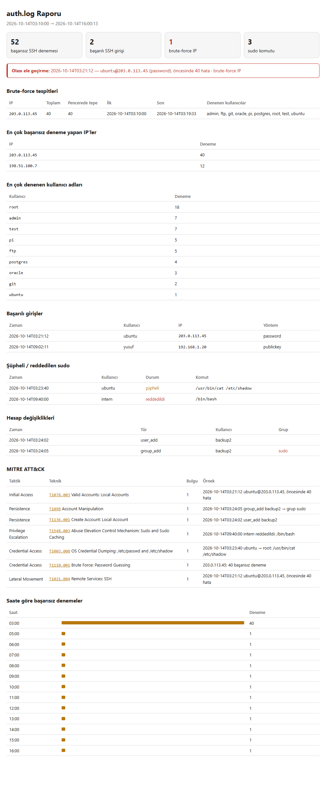
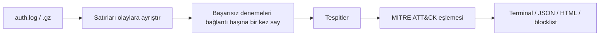

# auth-log-analyzer

[](https://github.com/yusufiyilmaz/auth-log-analyzer/actions/workflows/tests.yml)


[](LICENSE)

[English](README.md) | **Türkçe**

Linux `auth.log` dosyalarını analiz edip SSH saldırılarını, şüpheli `sudo` kullanımını ve hesap değişikliklerini raporlayan bir komut satırı aracı.
Bulgular **MITRE ATT&CK** tekniklerine eşlenir; aynı tespitler bir SIEM'de kullanılmak üzere **Sigma kuralları** olarak da sunulur.



## İçindekiler

- [Özellikler](#özellikler)
- [Hızlı başlangıç](#hızlı-başlangıç)
- [Kullanım](#kullanım)
- [Nasıl çalışır](#nasıl-çalışır)
- [Tespitler](#tespitler)
- [MITRE ATT&CK eşlemesi](#mitre-attck-eşlemesi)
- [Sigma kuralları](#sigma-kuralları)
- [Testler](#testler)
- [Proje yapısı](#proje-yapısı)
- [Sınırlamalar](#sınırlamalar)
- [Lisans](#lisans)

## Özellikler

- Her kaynak IP için kayan zaman penceresiyle **brute force tespiti**
- Aynı IP'den başarısız denemelerin ardından gelen başarılı girişte **olası ele geçirme uyarısı**
- **Şüpheli `sudo` komutları**, reddedilen `sudo`/`su` denemeleri, kullanıcı ve yetkili grup değişiklikleri
- Her bulgunun **MITRE ATT&CK** tekniğine eşlenmesi ve teknik sayfasına bağlanması
- `sigma check` ile doğrulanmış **5 Sigma kuralı**
- Terminal, JSON ve tek dosyalık HTML **rapor**; `iptables`/`fail2ban` için IP blocklist'i
- Arşivlenmiş `.gz` dosyaları dahil birden fazla dosyayı aynı anda okur
- **Bağımlılık yok:** yalnızca Python standart kütüphanesi (isteğe bağlı, çevrimdışı GeoIP)

## Hızlı başlangıç

```bash
git clone https://github.com/yusufiyilmaz/auth-log-analyzer.git
cd auth-log-analyzer
python analyzer.py samples/generated.log
```

Python 3.10 veya üstü gerekir. Gerçek bir sunucuyu analiz etmek için `/var/log/auth.log` dosyasını verin (okumak genellikle `sudo` gerektirir).

## Kullanım

```bash
python analyzer.py /var/log/auth.log
python analyzer.py auth.log auth.log.1 auth.log.2.gz --threshold 10 --window 5
python analyzer.py /var/log/auth.log --outdir raporlar
```

| Seçenek | Açıklama |
|---|---|
| `-t`, `--threshold` | Pencere içinde brute force sayılan başarısız deneme sayısı (varsayılan 5) |
| `-w`, `--window` | Brute force penceresi, dakika (varsayılan 10) |
| `-y`, `--year` | Klasik syslog satırlarında yıl yazmaz; logun başladığı yıl (varsayılan: bu yıl) |
| `-n`, `--top` | Listelerde gösterilecek satır sayısı |
| `--outdir KLASÖR` | HTML rapor, JSON rapor ve blocklist'i tarih-saat damgalı adlarla `KLASÖR`'e yazar |
| `--html`, `--json`, `--blocklist` | Tek bir çıktıyı belirli bir dosyaya yazar (`--json -` ekrana basar) |
| `--geoip-db MMDB` | Yerel GeoLite2 veritabanıyla IP'lerin ülkesini gösterir (`pip install geoip2`); hiçbir IP dışarı gönderilmez |
| `--no-color` | Renksiz terminal çıktısı |

**Çıkış kodları:** `2` olası ele geçirme, `1` brute force, `0` temiz. Böylece araç cron'dan veya bir script'ten çalıştırılıp sonucuna göre uyarı üretebilir.

<details>
<summary>Örnek terminal çıktısı (kısaltılmış)</summary>

```text
== !! OLASI ELE GEÇİRME — başarısız denemelerden sonra başarılı giriş
  2026-10-14T03:21:12  ubuntu@203.0.113.45  (password), öncesinde 40 hata [BRUTE-FORCE IP]

== Brute-force tespitleri (1) ==================================
  203.0.113.45   toplam 40 | pencerede tepe 40 | 2026-10-14T03:10:00 → 2026-10-14T03:19:33
      denenen: admin, ftp, git, oracle, pi, postgres …

== MITRE ATT&CK (7 teknik) =====================================
  T1078.003  Valid Accounts: Local Accounts  [Initial Access] ×1
  T1098      Account Manipulation  [Persistence] ×1
  T1136.001  Create Account: Local Account  [Persistence] ×1
  T1548.003  Abuse Elevation Control Mechanism: Sudo and Sudo Caching  [Privilege Escalation] ×1
  T1003.008  OS Credential Dumping: /etc/passwd and /etc/shadow  [Credential Access] ×1
  T1110.001  Brute Force: Password Guessing  [Credential Access] ×1
  T1021.004  Remote Services: SSH  [Lateral Movement] ×1
```
</details>

## Nasıl çalışır



1. Her satır bir olaya (zaman, host, kullanıcı, IP, port, tür) ayrıştırılır. Hem klasik syslog hem ISO 8601 zaman damgaları desteklenir.
2. **Başarısız denemeler bir kez sayılır.** OpenSSH, var olmayan bir kullanıcıyla yapılan tek deneme için iki satır yazar (`Invalid user` ve `Failed password for invalid user`). Araç bunları bağlantı üzerinden (IP ve kaynak port) eşler; aynı bağlantıda denenen birden fazla parola ise ayrı denemeler olarak sayılır.
3. Tespit kuralları olaylar üzerinde çalışır ve bulgular ATT&CK tekniklerine eşlenir.

## Tespitler

| Tespit | Mantık |
|---|---|
| Brute force | Bir IP'den kayan pencere içinde eşiği aşan başarısız denemeler |
| **Olası ele geçirme** | Daha önce başarısız denemesi olan bir IP'den başarılı giriş |
| Kullanıcı adı denemeleri | Sunucuda olmayan kullanıcı adlarıyla yapılan girişler |
| Şüpheli `sudo` | `/etc/shadow` okuma, shell açma, `useradd`, `curl \| sh`, `history -c` gibi komutlar |
| Reddedilen `sudo` / `su` | Yetki yükseltme hakkı olmayan kullanıcıların denemeleri |
| Hesap değişiklikleri | Yeni veya silinen kullanıcılar, parola değişiklikleri, `sudo`, `wheel`, `docker` gibi gruplara eklemeler |

## MITRE ATT&CK eşlemesi

Kurallar [mitre.py](mitre.py) dosyasındadır.

| Bulgu | Teknik |
|---|---|
| Brute force | T1110.001 Password Guessing |
| Başarısız denemelerden sonra başarılı giriş | T1078.003 Local Accounts, T1021.004 SSH |
| `sudo` ile `/etc/shadow` okuma | T1003.008 /etc/passwd and /etc/shadow |
| `sudo` ile shell, Python veya Perl çalıştırma | T1059.004, T1059.006, T1059 |
| Reddedilen `sudo` | T1548.003 Sudo and Sudo Caching |
| Yeni kullanıcı | T1136.001 Local Account |
| Yetkili gruba ekleme, parola değişikliği | T1098 Account Manipulation |
| Komut geçmişini silme, firewall kurallarını temizleme | T1070.003, T1562.004 |
| `wget`/`curl` ile indirme, `nc` | T1105, T1095 |

Bir tekniğin listelenmesi, logda ona uyan bir iz bulunduğunu gösterir; saldırının başarılı olduğunu göstermez.
Reddedilen `sudo` komutları hiç çalışmadığı için çalıştırmaya çalıştıkları komut olarak değil, yalnızca deneme (T1548.003) olarak eşlenir.

## Sigma kuralları

[sigma/](sigma/) klasöründeki kurallar aynı tespitleri Splunk, Elastic veya Wazuh gibi bir SIEM'e taşır. Hepsi `sigma check` ile doğrulandı ve örnek loglarda beklenen satırları yakalıyor.

| Kural | Teknik | Seviye |
|---|---|---|
| [lnx_sshd_invalid_user](sigma/lnx_sshd_invalid_user.yml) | T1110.001 | low |
| [lnx_sudo_not_in_sudoers](sigma/lnx_sudo_not_in_sudoers.yml) | T1548.003 | medium |
| [lnx_sudo_shadow_access](sigma/lnx_sudo_shadow_access.yml) | T1003.008 | high |
| [lnx_useradd_new_user](sigma/lnx_useradd_new_user.yml) | T1136.001 | low |
| [lnx_user_added_to_privileged_group](sigma/lnx_user_added_to_privileged_group.yml) | T1098 | medium |

```bash
pip install sigma-cli
sigma check sigma/
```

## Testler

```bash
python -m unittest -v
```

15 birim testi; deneme sayımını, brute force eşiğini, ele geçirme tespitini, `sudo` işlemeyi ve ATT&CK eşlemesini kontrol eder.
[GitHub Actions](.github/workflows/tests.yml) her push'ta testleri Python 3.10, 3.12 ve 3.13'te çalıştırır, analizörü iki örnek log üzerinde çalıştırır ve Sigma kurallarını doğrular.

## Proje yapısı

```text
analyzer.py          Ayrıştırma, tespitler ve raporlama
mitre.py             Bulgu → MITRE ATT&CK teknik eşlemesi
make_sample.py       Sentetik örnek log üretici
samples/             Sentetik auth.log dosyaları
sigma/               SIEM için Sigma kuralları
tests/               Birim testleri
docs/                README görselleri
```

## Örnek veri

`samples/` içindeki loglar **sentetiktir**: test için yazılmıştır, gerçek bir sunucudan alınmamıştır. Tüm IP adresleri dokümantasyon için ayrılmış aralıklardandır (RFC 5737).

- `samples/auth.log`: elle yazılmış kısa senaryo
- `samples/generated.log`: baştan sona bir saldırı zinciri, `python make_sample.py` ile yeniden üretilir

## Sınırlamalar

- Debian/Ubuntu `auth.log` biçimi için yazıldı ve onunla test edildi. RHEL/CentOS'taki `/var/log/secure` aynı syslog biçimini kullanır ancak test edilmedi; `journalctl` çıktısı da test edilmedi.
- Sigma kuralları tek tek log satırlarına bakar. Brute force için kaynak IP'nin ayrı bir alana ayrıştırılması gerektiğinden bu tespiti analizör yapar.
- SIEM'ler büyük/küçük harfe duyarsız aradığı için `Invalid user` kuralı aynı denemenin ikinci satırıyla da eşleşebilir. Analizör denemeleri bu tekrar olmadan sayar.

## Lisans

[MIT](LICENSE). Bu aracı yalnızca size ait olan veya izleme yetkiniz bulunan sistemlerde kullanın.
